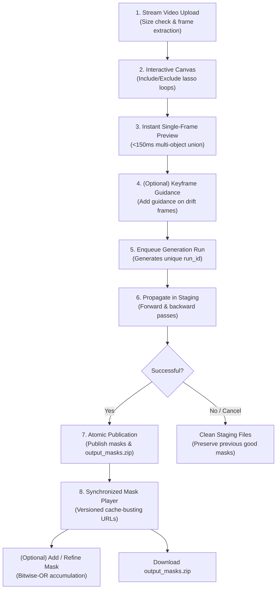

# stirs - Video Mask Generator (SAM 2)

An interactive, high-performance video mask generation system powered by **Meta SAM 2** with **SAM 2 Large** (`sam2.1_hiera_large`) as the primary model and automatic fallback to **SAM 2 Small** (`sam2.1_hiera_small`), a **FastAPI** backend, and a **React 18 + TypeScript + Vite** frontend.

Draw lasso loops around target subjects or secondary elements (e.g. cast shadows, water/floor reflections) on keyframes, and SAM 2 propagates the masks bidirectionally across the video. The final deliverable is `output_masks.zip` containing numbered 8-bit single-channel binary PNG masks (`00000.png`, `00001.png`, ...) adhering to the project output contract.

---

## Key Features

- **Multi-Object Separation & Union**:
  - Enclosing subject strokes and secondary reflection/shadow strokes are registered as distinct tracking entities (`obj_id=1`, `obj_id=2`), preventing high-contrast solid bodies from suppressing subtle reflections or shadows over temporal propagation.
  - Exclude strokes place negative prompt anchors distributed across all active objects.
  - Single-frame preview and full-video propagation both compute the pixelwise union of include objects.

- **Multi-Keyframe Refinement**:
  - Scrub to any frame where tracking slips or new elements enter the frame.
  - Add guidance strokes at arbitrary keyframes; SAM 2 conditions bidirectionally from all annotated frames.

- **Deterministic Fallback Engine**:
  - Environments without model weights or GPU acceleration use a deterministic geometric approximation engine supporting multi-keyframe, multi-object guidance, and mask accumulation.

- **Run Lifecycle & Safe Staging**:
  - Every mask generation task receives a unique `run_id` (UUID).
  - Mask generation runs write to isolated staging directories (`masks_staging_{run_id}` and `output_masks_staging_{run_id}.zip`).
  - Output is published atomically only upon successful completion. Failing or cancelling a rerun leaves existing masks undamaged.
  - Cache-busting revision tokens (`?v={run_id}`) version download links and frame mask URLs, ensuring browser and memory caches never display stale PNGs.

- **Cooperative Cancellation**:
  - In-flight propagation checks cooperative cancellation signals at frame boundaries.
  - Cancel endpoint (`DELETE /api/v1/jobs/{job_id}` / `POST /api/v1/jobs/{job_id}/cancel`) and frontend live progress cancel button safely clean up staging resources.

- **Streaming Uploads & Enforced Limits**:
  - Video uploads stream in 1MB chunks counting bytes against configurable thresholds (`MAX_UPLOAD_SIZE_BYTES`), returning HTTP 413 if exceeded.
  - Partial uploads and failed probe/extraction directories are automatically cleaned up.

- **Workspace Retention sweeps**:
  - Configurable retention sweeps (`WORKSPACE_RETENTION_HOURS`, default 24h) prune expired jobs asynchronously.
  - Actively running jobs are protected and path containment prevents deletions outside `WORKSPACE_DIR`.

- **Interactive Mask Preview Player**:
  - Synchronized video and mask playback using `requestVideoFrameCallback` with lookahead image preloading.
  - Three inspection modes: **Synced Overlay** (with Cyan, Red, Lime tints and opacity slider), **Split View** (source vs mask side-by-side), and **Binary Mask** (monochromatic inspection).
  - Seamless **Add / Refine Mask** accumulation workflow.

- **Per-Keyframe Stroke Undo & Redo**:
  - Bounded history stack (up to 50 steps) scoped per keyframe so frame switching preserves history.
  - Accessible canvas toolbar controls and keyboard shortcuts (`Ctrl+Z`, `Cmd+Z`, `Ctrl+Shift+Z`, `Cmd+Shift+Z`, `Ctrl+Y`).

---

## Architecture & Workflow



---

## API Reference

| Method | Endpoint | Description | Status Codes |
| :--- | :--- | :--- | :--- |
| `POST` | `/api/v1/videos/upload` | Streams video file in 1MB chunks, probes metadata, and extracts frames. | `200` (OK), `413` (Too Large), `400` (Invalid), `500` (Extraction Error) |
| `POST` | `/api/v1/masks/preview` | Generates instant single-frame preview mask for drawn strokes. | `200` (Base64 PNG + combined bbox), `404` (Not Found), `500` (Inference Error) |
| `POST` | `/api/v1/jobs/mask` | Initiates asynchronous SAM 2 mask propagation. Returns `job_id`, `run_id`, and `status: queued`. | `200` (Queued), `404` (Job Not Found), `409` (Active Run Conflict) |
| `POST` | `/api/v1/jobs/erase` | Backward-compatibility alias for `/api/v1/jobs/mask`. | `200`, `404`, `409` |
| `GET` | `/api/v1/jobs/{job_id}/status` | Queries run status (`?run_id=...` optional; defaults to latest run). | `200` (Status JSON) |
| `GET` | `/api/v1/jobs/{job_id}/events` | SSE stream reporting real-time pipeline events (`?run_id=...` optional). | `200` (Event Stream) |
| `POST` | `/api/v1/jobs/{job_id}/cancel` | Cooperatively cancels an in-flight or queued run. | `200` (Cancelled / Cancelling), `404` (Not Found) |
| `DELETE`| `/api/v1/jobs/{job_id}` | Idempotent cancellation endpoint. | `200` (Cancelled / Cancelling), `404` (Not Found) |
| `POST` | `/api/v1/workspace/cleanup` | Manually triggers workspace retention cleanup (`?max_age_hours=...` optional). | `200` (Cleaned count), `422` (Invalid Age) |

### Pipeline Event Stages

The SSE stream emits real-time progress events:
```json
{
  "stage": "queued | sam2_forward | sam2_backward | packaging | completed | failed | cancelled",
  "progress": 0,
  "run_id": "3fa85f64-5717-4562-b3fc-2c963f66afa6",
  "output_url": "/workspace/{job_id}/output_masks.zip?v={run_id}",
  "error": null
}
```

---

## Output Contract

- Archive file: `workspace/{job_id}/output_masks.zip`
- Files inside ZIP: Zero-padded sequential PNG images (`00000.png`, `00001.png`, ...) matching source frame indices.
- Format: Single-channel 8-bit grayscale PNG (`0` = background, `255` = target mask).
- Frame dimensions match the source video resolution.

---

## Keyboard Shortcuts

| Shortcut (Mac) | Shortcut (Windows/Linux) | Action |
| :--- | :--- | :--- |
| `⌘ + Z` | `Ctrl + Z` | Undo last stroke on active keyframe |
| `⌘ + ⇧ + Z` | `Ctrl + ⇧ + Z` / `Ctrl + Y` | Redo undone stroke on active keyframe |
| `Space` | `Space` | Play / Pause video in player or editor |

Shortcuts are automatically bypassed when focusing input fields or editable text areas.

---

## Configuration

Settings can be customized via environment variables:

| Variable | Type | Default | Description |
| :--- | :--- | :--- | :--- |
| `MAX_UPLOAD_SIZE_BYTES` | integer | `2147483648` (2 GB) | Maximum allowable video upload size in bytes. Returns HTTP 413 on breach. |
| `WORKSPACE_RETENTION_HOURS` | integer | `24` | Age threshold in hours before orphaned workspace jobs are eligible for cleanup. |
| `WORKSPACE_CLEANUP_INTERVAL_SECONDS` | float | `3600.0` (1 hr) | Interval between automatic background workspace retention sweeps. |
| `ENABLE_AUTO_WORKSPACE_CLEANUP` | boolean | `true` | Set to `false` to disable automatic background cleanup sweeps. |
| `DEFAULT_DILATION_PX` | integer | `7` | Default pixel radius for post-segmentation mask dilation. |
| `MAX_VIDEO_DIMENSION` | integer | `1920` | Max dimension for extracted JPEG frames (preserves 1:1 coordinates). |

---

## Project Structure

```text
stirs/
├── backend/
│   ├── config.py                 # Paths, device autodetection, limits, model variants
│   ├── main.py                   # FastAPI application, streaming uploads, SSE, static mounts
│   ├── schemas.py                # Pydantic request/response and progress models
│   ├── core/
│   │   ├── geometry.py           # Multi-object stroke conversion and bounding box calculation
│   │   ├── sam2_engine.py        # Cached SAM 2 singleton, AMP bfloat16, fallback tracking
│   │   └── video_io.py           # FFmpeg probing and numbered frame extraction
│   ├── tasks/
│   │   └── worker.py             # Run-scoped execution, safe staging, atomic publication
│   └── tests/
│       ├── test_api.py           # Full upload and propagation integration test
│       ├── test_geometry.py      # Stroke geometry, scribbles, and multi-object parsing
│       ├── test_preview_parity.py# Multi-object preview, fallback parity, and accumulation tests
│       └── test_upload_and_lifecycle.py # Upload limits, runs, cancellation, retention tests
├── frontend/
│   ├── src/
│   │   ├── App.tsx               # Primary workflow coordinator, run state, and keyboard shortcuts
│   │   ├── components/
│   │   │   ├── VideoLassoCanvas.tsx   # Interactive canvas with undo/redo floating controls
│   │   │   ├── MaskOverlay.tsx        # Instant single-frame preview overlay
│   │   │   ├── TimelineControls.tsx   # Video scrubber with keyframe bookmark pins
│   │   │   ├── LiveProgressTracker.tsx# Real-time telemetry, stage indicators, and Cancel button
│   │   │   └── MaskPreviewPlayer.tsx  # Synchronized player with cache-busting revision support
│   │   ├── types/api.ts          # TypeScript interfaces for API schemas and progress events
│   │   └── utils/
│   │       ├── coordinateMap.ts  # Aspect ratio & letterbox coordinate mapping
│   │       ├── coordinateMap.test.ts # Coordinate mapping unit tests
│   │       ├── strokeHistory.ts  # Per-keyframe bounded undo/redo history engine
│   │       └── strokeHistory.test.ts # Undo/redo boundary condition unit tests
│   └── package.json
├── checkpoints/sam2/             # SAM 2 weights directory (e.g. sam2.1_hiera_small.pt)
├── workspace/                    # Ephemeral job data (raw_video, frames, staging, published masks)
├── scripts/
│   ├── launch.sh                 # Single-command environment setup and application launcher
│   └── setup_weights.sh          # Automated checkpoint downloader
└── README.md
```

---

## Setup & Running

### Requirements
- **OS**: Linux, macOS, or Windows WSL2
- **Python**: 3.10+
- **Node.js**: 18+
- **FFmpeg**: Installed and available on system PATH
- **GPU (Optional)**: NVIDIA GPU with CUDA support for real-time SAM 2 tracking (runs comfortably on 4GB VRAM such as RTX 2050 via `bfloat16` AMP and CPU state offloading).

### One-Command Setup & Launch
```bash
./scripts/launch.sh
```
This script provides complete one-command setup across all major Linux distributions (Ubuntu/Debian, Arch/Manjaro, Fedora/RHEL, openSUSE, Alpine, Void, etc.) and macOS:
1. **Multi-Distro Dependency Check**: Detects the Linux distribution and package manager (`pacman`, `apt`, `dnf`, `zypper`, `apk`, `xbps`, `brew`), verifies required system tools (`python3`, `python3-venv`, `node >= 18`, `npm`, `ffmpeg`, `curl`), and interactively prompts the user to install any missing packages automatically.
2. **Model Weights Setup**: Automatically checks for SAM 2 weights and downloads the primary checkpoint (`sam2.1_hiera_large.pt`, with fallback to `sam2.1_hiera_small.pt` from Meta CDN) with retry and integrity checks if not already present.
3. **Environment & Dependencies**: Sets up the Python virtual environment (`.venv`), installs backend requirements (`backend/requirements.txt`), and installs frontend npm packages.
4. **Service Orchestration**: Starts both the FastAPI backend (`http://localhost:8000`) and Vite frontend (`http://localhost:3000`) with clean signal trapping and shutdown handling.

### Manual Setup

1. **Backend**:
   ```bash
   python3 -m venv .venv
   source .venv/bin/activate
   pip install -r backend/requirements.txt
   PYTHONPATH=backend uvicorn main:app --host 0.0.0.0 --port 8000 --reload
   ```

2. **Frontend**:
   ```bash
   cd frontend
   npm install
   npm run dev
   ```

---

## Testing

Run the full backend test suite:
```bash
./.venv/bin/pytest backend/tests
```

Run the frontend tests and production build check:
```bash
npm --prefix frontend test -- --run
npm --prefix frontend run build
```
