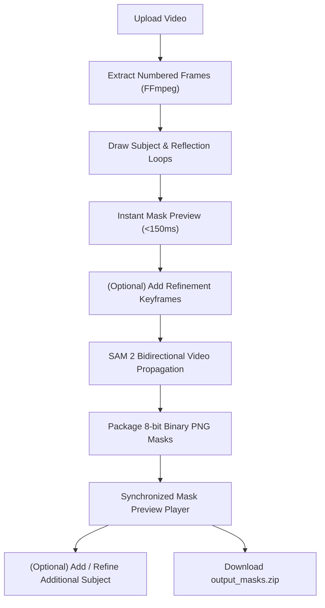

# stirs - Video Mask Generator (SAM 2)

An interactive video mask generation application (`stirs`). Draw around an object or secondary temporal element (cast shadows, water/floor reflections) on any keyframe, and SAM 2 (`sam2.1_hiera_small` / `sam2.1_hiera_large`) propagates those selections bidirectionally across the video. The final deliverable is `output_masks.zip` containing numbered 8-bit single-channel binary PNG masks (`00000.png`, ...).

## Features

- **Multi-Object Separation**: Enclosing subject strokes and secondary reflection/shadow strokes are registered as distinct tracking entities in SAM 2 (`obj_id=1`, `obj_id=2`), preventing high-contrast solid bodies from suppressing low-contrast reflections over time. Masks are unioned frame-by-frame.
- **Multi-Keyframe Refinement**: Scrub to any frame where tracking drifts or elements enter, add guidance strokes, and propagate bidirectionally with multi-frame conditioning.
- **Post-Processing Accumulation Mode**: Click **Add / Refine Mask** in the preview player to track secondary subjects or missed elements non-destructively, merging them via bitwise-OR into existing mask sequences.
- **Interactive Mask Preview Player**: Frame-accurate synchronized playback with hardware presentation callbacks (`requestVideoFrameCallback`), lookahead image caching, configurable color tints (Cyan, Red, Lime), opacity controls, split view, and mask-only inspection.
- **Local GPU Optimization**: Persistent cached SAM 2 singleton with native `bfloat16` AMP acceleration and CPU state offloading, running comfortably on 4GB VRAM (e.g. RTX 2050).

## Workflow



## Project Layout

```text
backend/
  core/geometry.py        Stroke parsing, prompt extraction, and multi-object dispatch
  core/sam2_engine.py    Cached singleton SAM 2 predictor with bfloat16 AMP & multi-object propagation
  core/video_io.py       FFmpeg video probing and frame extraction
  tasks/worker.py        Async job runner, coordinate scaling, and ZIP packaging
  main.py                FastAPI endpoints and SSE event streaming
  schemas.py             Pydantic models supporting multi-keyframe requests and accumulation
frontend/src/
  App.tsx                Main workflow coordinator (upload, keyframes, accumulation, SSE)
  components/
    VideoLassoCanvas.tsx Interactive canvas with letterbox-aware coordinate mapping
    MaskPreviewPlayer.tsx Frame-accurate synchronized player with overlay/split/mask modes
    TimelineControls.tsx Scrubber with keyframe bookmark pins and frame stepping
    MaskOverlay.tsx      Translucent single-frame preview overlay
    LiveProgressTracker.tsx Real-time progress bar for forward/backward propagation
  utils/coordinateMap.ts Letterbox/pillarbox coordinate conversions
workspace/{job_id}/
  frames/                Extracted JPEG video frames
  masks/                 Propagated binary PNG masks (0 = background, 255 = target)
  output_masks.zip       Final downloadable ZIP archive
```

## Setup & Launch

Prerequisites: Python 3.10+, Node 18+, and FFmpeg.

### One-Command Launch

```bash
./scripts/launch.sh
```

The launcher configures the virtual environment, installs dependencies, verifies weights, and starts both the FastAPI backend (`http://localhost:8000`) and the Vite frontend (`http://localhost:3000`).

### Manual Setup

Backend:
```bash
python3 -m venv .venv
source .venv/bin/activate
pip install -r backend/requirements.txt
PYTHONPATH=backend uvicorn main:app --host 0.0.0.0 --port 8000 --reload
```

Frontend:
```bash
cd frontend
npm install
npm run dev
```

## Configuration

Key environment variables:
- `MAX_UPLOAD_SIZE_BYTES`: Maximum allowable video upload size in bytes (default: `2147483648` = 2GB). Requests exceeding this limit return HTTP 413.
- `WORKSPACE_RETENTION_HOURS`: Age threshold in hours before orphaned workspace jobs are eligible for cleanup (default: `24`).
- `WORKSPACE_CLEANUP_INTERVAL_SECONDS`: Interval in seconds between automatic background retention sweeps (default: `3600.0`).
- `ENABLE_AUTO_WORKSPACE_CLEANUP`: Set to `false` or `0` to disable automatic background cleanup loop (default: `true`).

## Workspace Retention, Cancellation & Endpoints

- **Job Cancellation**: In-flight jobs can be cooperatively cancelled via `DELETE /api/v1/jobs/{job_id}` or `POST /api/v1/jobs/{job_id}/cancel` (with optional `run_id`). The UI displays an in-flight Cancel button and handles cooperative cancellation cleanly.
- **Run Versioning & Staging**: Each generation run receives a unique `run_id`. Intermediate masks and ZIP archives are staged in isolated run directories, atomically publishing upon completion. Failing or cancelling a rerun leaves previously published mask outputs undamaged.
- **Automatic retention sweeps**: Run asynchronously without blocking server startup or API requests.
- **Manual cleanup endpoint**: `POST /api/v1/workspace/cleanup` accepts an optional positive `max_age_hours` (via query param or JSON body). Non-positive values return HTTP 422.
- Deletions are strictly contained within `config.WORKSPACE_DIR` and actively executing jobs are protected from deletion.

## Keyboard Shortcuts

- `Ctrl+Z` / `Cmd+Z`: Undo stroke on current keyframe
- `Ctrl+Shift+Z` / `Cmd+Shift+Z` / `Ctrl+Y`: Redo stroke on current keyframe


## Testing

Run backend tests:
```bash
./.venv/bin/pytest backend/tests
```

Run frontend tests & build:
```bash
npm --prefix frontend test -- --run
npm --prefix frontend run build
```
