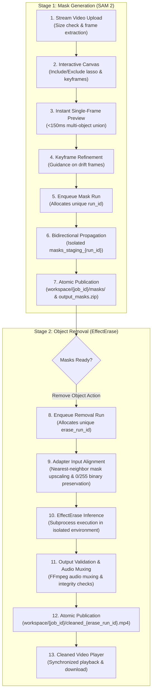

# stirs - Video Mask Generation & Object Removal (SAM 2 & EffectErase)

An interactive, high-performance two-stage video inpainting and editing system combining:
1. **Stage 1: Mask Generation (Meta SAM 2)** — Interactive video segmentation powered by **SAM 2 Large** (`sam2.1_hiera_large`) with automatic fallback to **SAM 2 Small** (`sam2.1_hiera_small`).
2. **Stage 2: Object & Effect Removal (EffectErase)** — Advanced video removal powered by [EffectErase](https://github.com/FudanCVL/EffectErase) (CVPR 2026 / arXiv:2603.19224), built on Wan2.1, which removes selected objects together with their secondary effects (cast shadows, reflections, lighting changes, deformations) while preserving source audio.

---

## Two-Stage User Workflow



---

## Key Features

### Stage 1: SAM 2 Mask Generation
- **Primary SAM 2 Large with Automated Small Fallback**:
  - Leverages **SAM 2.1 Hiera Large** (`sam2.1_hiera_large.pt`) as the primary high-accuracy model.
  - Automatically checks VRAM (< 1.2 GB free) and catches CUDA `OutOfMemoryError` during propagation or loading, gracefully falling back to **SAM 2.1 Hiera Small** (`sam2.1_hiera_small.pt`) with zero disruption.
- **Full-Page Studio UI (VEED.IO Inspired)**:
  - Responsive full-screen studio layout (`w-screen h-screen overflow-hidden`) maximizing canvas real estate.
  - Smart Selection Tools: **Freehand Lasso** (`1`), **Bounding Box** (`2`), and **Point Prompts** (`3`).
  - High-visibility **Include** (`I`, cyan) and **Exclude** (`E`, rose) prompt modes.
  - **Peek Mode** (`H`): Instantly toggle visibility of masks and annotations to examine the clean raw frame.
  - **Procedural Sample Videos**: Built-in procedural video generator (`Moving Sphere`, `Pulsing Hexagon`, `Dual Orbiting Circles`) allowing instant end-to-end testing without external file uploads.
- **Multi-Object Separation & Union**:
  - Enclosing subject strokes and secondary reflection/shadow strokes are registered as distinct tracking entities (`obj_id=1`, `obj_id=2`), preventing high-contrast solid bodies from suppressing subtle reflections or shadows over temporal propagation.
  - Exclude strokes place negative prompt anchors distributed across all active objects.
- **Interactive Mask Inspection Player**:
  - Synchronized video and mask playback using `requestVideoFrameCallback` with lookahead image preloading.
  - Four inspection modes: **Interactive Split Curtain Wipe** (with draggable split divider), **Synced Overlay** (with Cyan, Red, Lime tints and opacity slider), **Split View** (source vs mask side-by-side), and **Binary Mask** (monochromatic inspection).
  - Variable playback speed (`0.25x`, `0.5x`, `1x`, `1.5x`, `2x`), loop playback, and fullscreen viewer.
  - Seamless **Add / Refine Mask** accumulation workflow and `output_masks.zip` export.

### Stage 2: EffectErase Video Object Removal
- **Task-Aware Effect Removal**:
  - Integrates upstream [EffectErase](https://github.com/FudanCVL/EffectErase) built on Wan2.1. Unlike simple patch inpainting, EffectErase removes both the marked object and its associated secondary physical effects (shadows, glossy reflections, ambient color spill, and background deformations).
- **Subprocess & Environment Isolation**:
  - Heavy inference dependencies (Wan2.1, DiffSynth, PyTorch with flash-attention) are kept completely out of the core web backend. The adapter invokes an isolated Python executable via subprocess arguments with safe signal propagation and bounded output logging.
- **Strict Mask Alignment & Binary Preservation**:
  - Upscales downscaled SAM 2 mask frames back to original source video dimensions using exact nearest-neighbor interpolation, ensuring strict binary values (`0` and `255`) and preserving pixel alignment.
- **Lossless Audio Preservation**:
  - Upstream diffusion inpainting models produce silent video. Stirs probes source audio streams and uses FFmpeg to mux the original audio back into the cleaned video output without re-encoding quality degradation.
- **Run-Scoped Staging & Atomic Publication**:
  - Every removal job receives a unique `erase_run_id` distinct from the upload `job_id` and mask `run_id`.
  - Inference writes into an isolated directory `workspace/{job_id}/removal_staging_{erase_run_id}/`.
  - Validated and published atomically only upon complete success. Any cancellation or failure immediately purges the staging area while keeping any previously generated cleaned video intact.
- **Cleaned Video Player & Cache-Busted Downloads**:
  - UI presents dedicated cleaned video playback controls and versioned download links (`?v={erase_run_id}`) preventing stale browser caching.
  - Existing mask inspection and mask ZIP downloads remain fully accessible.

---

## Upstream EffectErase & Noncommercial License Notice

> [!IMPORTANT]
> **Noncommercial License Notice**: EffectErase is research software released by Fudan University under the **Creative Commons Attribution-NonCommercial 4.0 International (CC BY-NC 4.0)** license.
> Model weights and code are provided strictly for research and non-commercial educational purposes. Any commercial deployment or monetization of the EffectErase model weights is prohibited without upstream licensing.
>
> - **Paper**: [EffectErase: Joint Object and Effect Video Removal via Region Guidance and Effect Consistency](https://arxiv.org/abs/2603.19224) (Fu et al., CVPR 2026)
> - **Code Repository**: [FudanCVL/EffectErase](https://github.com/FudanCVL/EffectErase)
> - **Project Page**: [henghuiding.com/EffectErase](https://henghuiding.com/EffectErase/)
> - **Base Model**: Wan2.1-Fun-1.3B-InP

> [!NOTE]
> **Generative Behavior Notice**: EffectErase is a generative diffusion model. It is designed to extrapolate background context and remove secondary effects, but output quality depends on prompt fidelity, scene complexity, and motion dynamics. In complex scenes with overlapping reflections or ambiguous object boundaries, generative artifacts may occur.

---

## Hardware & Runtime Requirements

### Stage 1 (Mask Generation / SAM 2)
- **Minimum VRAM**: 4 GB NVIDIA GPU (e.g., RTX 2050/3050) with `bfloat16` AMP and CPU state offloading.
- **Fallback**: Automated fallback to SAM 2 Small or CPU deterministic geometric preview engine when GPU is unavailable.

### Stage 2 (Object Removal / EffectErase)
- **Separate Runtime**: EffectErase is an optional second stage. Core SAM 2 mask generation and mask export work completely without EffectErase installed.
- **Hardware**: NVIDIA GPU with CUDA (recommended >= 16 GB - 24 GB VRAM for 720p/1080p full inference).
- **Checkpoints**:
  - Base Wan2.1 Inpainting Model (~19 GB)
  - EffectErase checkpoint (`diffusion_pytorch_model.safetensors`)

---

## API Reference

### Video & Mask Generation Endpoints (Stage 1)

| Method | Endpoint | Description | Status Codes |
| :--- | :--- | :--- | :--- |
| `POST` | `/api/v1/videos/upload` | Streams video file in 1MB chunks, probes metadata, extracts frames. | `200` (OK), `413` (Too Large), `400` (Invalid), `500` (Error) |
| `POST` | `/api/v1/masks/preview` | Generates instant single-frame preview mask for drawn strokes. | `200` (Base64 PNG + combined bbox), `404` (Not Found), `500` (Error) |
| `POST` | `/api/v1/jobs/mask` | Enqueues asynchronous SAM 2 mask propagation. Returns `job_id`, `run_id`, `status: queued`. | `200` (Queued), `404` (Not Found), `409` (Active Run Conflict) |
| `POST` | `/api/v1/jobs/erase` | Backward-compatibility alias for `/api/v1/jobs/mask`. | `200`, `404`, `409` |
| `GET` | `/api/v1/jobs/{job_id}/status` | Queries mask run status (`?run_id=...` optional; defaults to latest run). | `200` (Status JSON) |
| `GET` | `/api/v1/jobs/{job_id}/events` | SSE stream reporting real-time mask pipeline events. | `200` (Event Stream) |
| `POST` | `/api/v1/jobs/{job_id}/cancel` | Cooperatively cancels an in-flight mask generation run. | `200` (Cancelled / Cancelling), `404` (Not Found) |
| `DELETE`| `/api/v1/jobs/{job_id}` | Idempotent cancellation endpoint. | `200` (Cancelled / Cancelling), `404` (Not Found) |
| `POST` | `/api/v1/workspace/cleanup` | Triggers workspace retention cleanup (`?max_age_hours=...` optional). | `200` (Cleaned count), `422` (Invalid Age) |

### Object Removal Endpoints (Stage 2)

| Method | Endpoint | Description | Status Codes |
| :--- | :--- | :--- | :--- |
| `POST` | `/api/v1/jobs/{job_id}/removal` | Enqueues EffectErase object removal run. Requires completed masks. Returns `job_id`, `erase_run_id`, `status: queued`. | `200` (Queued), `400` (No masks or missing video), `409` (Active Run Conflict), `503` (Runtime Unavailable) |
| `GET` | `/api/v1/jobs/{job_id}/removal/{erase_run_id}/status` | Queries run-scoped removal status and stage. | `200` (Status JSON), `404` (Not Found) |
| `GET` | `/api/v1/jobs/{job_id}/removal/{erase_run_id}/events` | SSE stream reporting run-scoped removal stage transitions and progress. | `200` (Event Stream), `404` (Not Found) |
| `POST` | `/api/v1/jobs/{job_id}/removal/{erase_run_id}/cancel` | Cooperatively cancels an in-flight removal run and terminates subprocess. | `200` (Cancelled / Cancelling), `404` (Not Found) |
| `GET` | `/api/v1/jobs/{job_id}/removal/{erase_run_id}/result` | Streams/downloads published cleaned video with `Cache-Control: no-cache`. | `200` (video/mp4), `404` (Not Ready / Not Found) |

#### Removal Pipeline Event Stages

The removal SSE stream emits events structured as:
```json
{
  "job_id": "c1f7a0b3-90d1-4b11-a831-419b48f65e2a",
  "erase_run_id": "6df8d341-a185-4841-944a-115f5c3a4d33",
  "stage": "queued | preparing_input | loading_model | inference | validating_output | publishing | completed | failed | cancelled",
  "progress": 75,
  "output_url": "/api/v1/jobs/c1f7a0b3.../removal/6df8d341.../result",
  "result_url": "/api/v1/jobs/c1f7a0b3.../removal/6df8d341.../result",
  "message": "Inference in progress",
  "error": null
}
```

---

## Output Contract

### Mask Generation Deliverables (Stage 1)
- Archive file: `workspace/{job_id}/output_masks.zip`
- Mask directory: `workspace/{job_id}/masks/`
- Files: Zero-padded sequential PNG images (`00000.png`, `00001.png`, ...) matching source frame indices.
- Format: Single-channel 8-bit grayscale PNG (`0` = background, `255` = target mask).
- Frame dimensions match the source video resolution.

### Cleaned Video Deliverables (Stage 2)
- Cleaned Video File: `workspace/{job_id}/cleaned_{erase_run_id}.mp4`
- Download route: `/api/v1/jobs/{job_id}/removal/{erase_run_id}/result`
- Validated container: MP4 video containing in-painted visual frames, matching source resolution and framerate.
- Audio: Source audio stream muxed into output when present in uploaded video.

---

## Configuration Reference

Settings can be customized via environment variables:

### Core & SAM 2 Settings
| Variable | Type | Default | Description |
| :--- | :--- | :--- | :--- |
| `DEFAULT_SAM2_CONFIG` | string | `configs/sam2.1/sam2.1_hiera_l.yaml` | Primary SAM 2 configuration file. |
| `DEFAULT_SAM2_CHECKPOINT` | string | `checkpoints/sam2/sam2.1_hiera_large.pt` | Primary SAM 2 Large checkpoint path. |
| `FALLBACK_SAM2_CONFIG` | string | `configs/sam2.1/sam2.1_hiera_s.yaml` | Fallback SAM 2 Small configuration file. |
| `FALLBACK_SAM2_CHECKPOINT` | string | `checkpoints/sam2/sam2.1_hiera_small.pt` | Fallback SAM 2 Small checkpoint path. |
| `MAX_UPLOAD_SIZE_BYTES` | integer | `2147483648` (2 GB) | Maximum allowable video upload size in bytes. Returns HTTP 413 on breach. |
| `WORKSPACE_RETENTION_HOURS` | integer | `24` | Age threshold in hours before orphaned workspace jobs are eligible for cleanup. |
| `WORKSPACE_CLEANUP_INTERVAL_SECONDS` | float | `3600.0` (1 hr) | Interval between automatic background workspace retention sweeps. |
| `ENABLE_AUTO_WORKSPACE_CLEANUP` | boolean | `true` | Set to `false` to disable automatic background cleanup sweeps. |
| `DEFAULT_DILATION_PX` | integer | `7` | Default pixel radius for post-segmentation mask dilation. |
| `MAX_VIDEO_DIMENSION` | integer | `1920` | Max dimension for extracted JPEG frames (preserves 1:1 coordinates). |

### EffectErase Removal Settings
| Variable | Type | Default | Description |
| :--- | :--- | :--- | :--- |
| `EFFECT_ERASE_REPO_DIR` | path | `external/EffectErase` | Path to upstream EffectErase cloned repository. |
| `EFFECT_ERASE_CHECKPOINTS_DIR` | path | `checkpoints/effect_erase` | Directory holding EffectErase checkpoint and Wan2.1 weights. |
| `EFFECT_ERASE_PYTHON` | string | `""` (or system python) | Path to isolated Python interpreter with Wan/DiffSynth dependencies. |
| `EFFECT_ERASE_DEVICE` | string | `cuda` (or autodetected) | Execution device for EffectErase (`cuda` or `cpu`). |
| `EFFECT_ERASE_TIMEOUT_SECONDS`| float | `1800.0` (30 min) | Subprocess execution timeout before raising cancellation error. |

---

## Setup & Running

### Requirements
- **OS**: Linux, macOS, or Windows WSL2
- **Python**: 3.10+
- **Node.js**: 18+
- **FFmpeg**: Installed and available on system PATH
- **GPU (Recommended)**: NVIDIA GPU with CUDA support for real-time SAM 2 tracking and EffectErase removal.

### Setup and Launch

```bash
# Install the application, SAM 2, and frontend dependencies, then start both services
./scripts/launch.sh
```

The launcher runs `scripts/setup.sh` first. It installs missing system packages when approved, prepares the app's Python environment, installs backend and frontend dependencies, installs SAM 2, and downloads SAM 2 weights. Stop both services with Ctrl+C.

### EffectErase Runtime Setup (Optional)

To set up object removal as well, use:

```bash
./scripts/launch.sh --with-effecterase
```

This option also installs the isolated EffectErase Python runtime and downloads the Wan2.1 base model (about 19 GB) and EffectErase checkpoint into `checkpoints/effect_erase/`. It pins the upstream code to `bcee0a5da5ef387c2ba39390dc4d579503669fb8`, the revision used by the adapter. The launcher configures the adapter paths automatically. It requires a CUDA-capable NVIDIA GPU for inference; check `/api/v1/removal/preflight` after startup. The installer uses the upstream [EffectErase setup](https://github.com/FudanCVL/EffectErase). Its code and model are licensed CC BY-NC 4.0.

The setup script can also be run without starting the app:

```bash
bash scripts/setup.sh                 # app, SAM 2, and frontend
bash scripts/setup.sh --with-effecterase  # additionally install removal runtime and weights
```

---

## Testing

Run the full backend test suite (unit tests, adapter tests, and API lifecycle tests):
```bash
./.venv/bin/pytest backend/tests
```

Run frontend unit tests and production build verification:
```bash
npm --prefix frontend test -- --run
npm --prefix frontend run build
```
